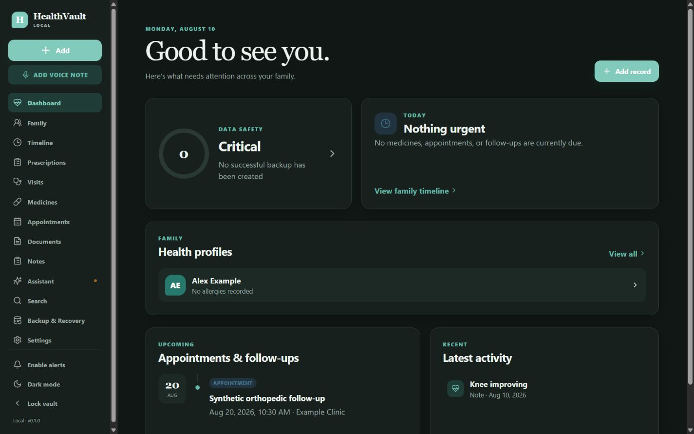
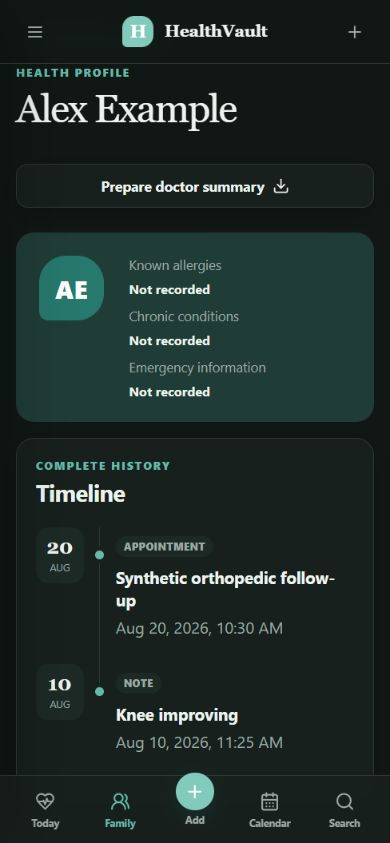

# HealthVault Local

HealthVault Local is a private, local-first family health and prescription archive. It keeps structured records in SQLite, preserves original medical files byte-for-byte outside the database, supports exact full-text search, and creates encrypted, independently verifiable recovery archives.

Version `0.1.0` is a modular monolith: one FastAPI process serves both the API and the built responsive React application. Internet access is not required for records, documents, search, reminders, calendar export, data export, backup, verification, test restore, or full restore. No telemetry is included.





> Medical safety: HealthVault organizes personal records. It does not diagnose, prescribe, change doses, or replace a healthcare professional. OCR and AI outputs are unverified proposals until a person explicitly confirms them.

## Highlights

- Multiple family health profiles with combined chronological timelines
- Visits, prescriptions, medication schedules, dose events, appointments, follow-ups, notes, measurements, providers, reminders, and tags
- Immutable PDF/JPEG/PNG/HEIC originals with SHA-256 exact duplicate detection and separate thumbnails/OCR evidence
- SQLite FTS5 search across doctors, medicines, diagnoses, symptoms, notes, documents, and OCR
- AES-256-GCM encrypted `.hvault` backups with scrypt key derivation, manifests, SHA-256 checksums, SQLite integrity checks, multiple filesystem destinations, verification, test restore, and emergency snapshots before live restore
- Versioned, framework-independent JSON/CSV/Markdown export with originals and schema documentation
- Local Ollama and faster-whisper provider boundaries; both disable cleanly when unavailable
- Standard `.ics` appointment export and browser/desktop notifications while the host is running
- Local password lock, Argon2id hashing, sliding sessions, CSRF protection, strict same-site cookies, MIME validation, CSP, and no remote analytics
- Responsive light/dark/system interface with keyboard focus and mobile touch targets

## Requirements

- Windows 10/11
- Python 3.12+
- Node.js 20+
- Git
- Optional OCR: Tesseract installed locally and available on `PATH`
- Optional AI: [Ollama](https://ollama.com/) with a locally installed model
- Optional voice transcription: install with `install.ps1 -WithVoice`; the first Whisper model use requires a local model download

## Install

```powershell
git clone <your-private-repository-url>
cd "Prescription Management System"
.\install.ps1
```

If a corporate proxy replaces TLS certificates, configure the trusted certificate in npm/pip rather than permanently disabling certificate verification.

## Start

```powershell
.\start.ps1
```

The browser opens at `http://127.0.0.1:8765`. Production mode is one local service; Node is not needed after the frontend has been built.

First launch guides you through creating the vault password and first profile, explains the data location, puts encrypted backup configuration in the main flow, checks optional AI, and strongly recommends an independent second backup.

## Data location and privacy

The default live vault is `data/`. It is excluded from Git. Override it before startup if desired:

```powershell
$env:HEALTHVAULT_DATA_DIR = 'D:\HealthVaultData'
.\start.ps1
```

Never place live medical records under `fixtures/`; that directory is for obviously synthetic records only. Run `scripts/install_git_hooks.ps1` to install the privacy guard if `install.ps1` was not used.

## Backup and restore

Open **Backup & Recovery** and add at least two generic filesystem destinations, such as an external drive and a OneDrive-synchronized folder. Create an encrypted backup, then use **Verify backup** and **Test restore**. The backup password is user-controlled, is never stored in an archive, and cannot be recovered.

Full restoration always creates an encrypted emergency backup of current data before replacing the database. See [BACKUP_AND_RECOVERY.md](BACKUP_AND_RECOVERY.md) for failure scenarios, retention, CLI/API flows, and new-computer recovery.

## Local OCR, AI, and voice

- OCR: PDF embedded text extraction works with the standard install. Image OCR requires the free Tesseract executable. Original OCR is preserved separately from corrected text.
- AI: set `HEALTHVAULT_OLLAMA_MODEL` to the exact local model name. AI only receives retrieved local record snippets through localhost and cannot write health records directly.
- Voice: the original recording is stored even when transcription is unavailable. Local Whisper transcription and structured extraction remain review-only.

## Phone/tablet access on private Wi-Fi

First finish setup on the host computer. Then:

```powershell
.\start.ps1 -Lan
```

Allow Python only on **Private** networks in Windows Firewall, find the computer's private IPv4 address with `ipconfig`, and open `http://<private-ip>:8765` on the other device. LAN access always uses the application password. Do not port-forward this service or expose it to the public internet. Plain HTTP is acceptable only on a trusted home network; [SECURITY.md](SECURITY.md) describes optional local HTTPS with Caddy or a private certificate.

## Development and verification

```powershell
.\.venv\Scripts\python.exe -m pytest
npm test
npm run lint
npm run build
```

API documentation is available locally at `http://127.0.0.1:8765/api/docs`. See [DEVELOPMENT.md](DEVELOPMENT.md), [TESTING.md](TESTING.md), and [ARCHITECTURE.md](ARCHITECTURE.md).

## Moving to a new computer

1. On the old computer, create and test-restore a current `.hvault` backup.
2. Copy that single encrypted archive to the new computer.
3. Install the same or newer HealthVault Local release.
4. Start once, create a temporary empty vault, and open **Backup & Recovery**.
5. Select the archive, enter its backup password, verify, test restore, then perform full restore.
6. Restart, sign in, confirm profile/document counts, and immediately configure two new destinations.

The archive contains the database, original documents, voice files, manifest, versions, and checksums required for application-independent recovery.

## Known limits in v0.1.0

- When the host computer is off, local notifications cannot fire. Export `.ics` events to a phone calendar for critical reminders.
- Handwritten medical OCR is inherently unreliable. Low-confidence text must be verified against the original or a healthcare professional.
- The app does not provide transparent live database encryption at rest. Use Windows device encryption/BitLocker; encrypted backups are mandatory.
- Automatic daily backup runs while the application is running and the locally protected backup credential has been unlocked by login.
- HEIC support depends on the installed Pillow HEIF codec; browser display support varies, but originals remain downloadable.

## Documentation

[Architecture](ARCHITECTURE.md) · [Data model](DATA_MODEL.md) · [Backup & recovery](BACKUP_AND_RECOVERY.md) · [Security](SECURITY.md) · [Privacy](PRIVACY.md) · [Portable data format](DATA_FORMAT.md) · [Development](DEVELOPMENT.md) · [Testing](TESTING.md) · [Contributing](CONTRIBUTING.md) · [Changelog](CHANGELOG.md)
